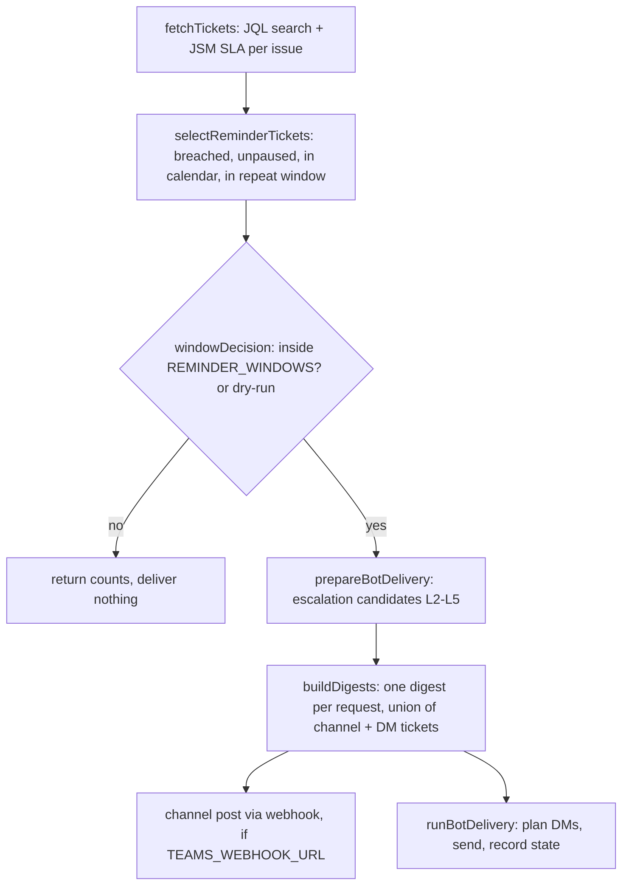

# Architecture

One Flue workflow, run by GitHub Actions twice a working day. No server, no DB.
The only persisted state is the escalation state file (see [data.md](data.md)).

## Run flow — `runJiraTeamsReminder` (`src/workflows/jira-teams-reminder.ts:133`)

| Step | Where |
| --- | --- |
| Fetch tickets + both SLA metrics | `src/shared/jira.ts:97` |
| First-response selection | `src/reminder/sla.ts:23` |
| Delivery-window clock check | `src/reminder/delivery-windows.ts:85`, called at workflow `:163` |
| Empty scan fails (non-dry-run) | workflow `:169` |
| Escalation candidates | `src/escalation/escalation.ts:127`, called at workflow `:299` |
| Digests (owner deterministic, prose optional model) | `src/escalation/ticket-digest.ts:269`, workflow `:445` |
| Optional model intro (aggregate counts only) | `src/reminder/reminder-intro.ts:54` |
| Channel message build / post | `src/reminder/reminder-message.ts:34`, `src/shared/teams-webhook.ts:4` |
| DM planning (recipients, allowlist, chunks) | `src/escalation/direct-messages.ts:70` |
| DM send (token, Graph install, Bot Connector) | `src/shared/teams-bot.ts:66` |
| Run journal (counts-only CI log) | `src/reminder/run-journal.ts:96` |

## Modules

| Path | Role |
| --- | --- |
| `src/shared/config.ts` | all env parsing and bounds; the only place `process.env` is read for a run |
| `src/shared/http.ts` | `fetchOk`: timeout, bounded retry on 429/5xx, Retry-After capped at 60s (`:5`, `:79`) |
| `src/shared/jira.ts` | Jira search + JSM SLA adapter; participant/comment author filtering |
| `src/reminder/sla.ts` | pure selection; `overdueMinutes` vs `elapsedSinceRaisedMinutes` |
| `src/escalation/escalation*.ts` | policy (pure), directory loader, state file |
| `src/escalation/direct-messages.ts` | pure per-recipient plan |
| `src/escalation/ticket-digest.ts` | `DigestTicketView` (identity-free), owner resolution, model prompt, fallback |
| `src/agents/*.ts` | thin Flue `defineAgent` bindings; prompt text lives in the feature folder |
| `frontend/src/features/<name>/` | one folder per screen: monthly-report, support-report, reports-archive, chat, teams |
| `frontend/src/shared/` | code used by 2+ features: `utils/` (api-client, report-requests, format, colors), `i18n.tsx`, `components/` (layout, common, ExportActions); `components/ui/` + `lib/utils.ts` stay (shadcn aliases) |
| `scripts/` | local tools: trace, verify bot, resolve Entra ids, package Teams app, toolchain check |
| `packages/teams-app/` | Teams app manifest + icons (`npm run package:teams`) |
| `config/escalation.example.json` | directory shape; real `config/escalation.json` is gitignored |

Two transports, independent: webhook alone or bot alone is a valid deployment
(`src/shared/config.ts:160`). Bot config is null when `TEAMS_BOT_APP_ID` and
`TEAMS_BOT_TENANT_ID` are both unset (`config.ts:224`).

Dependency seam for tests: `WorkflowDependencies` (`workflow :72-101`) — tests pass
fakes through `options.dependencies`.
